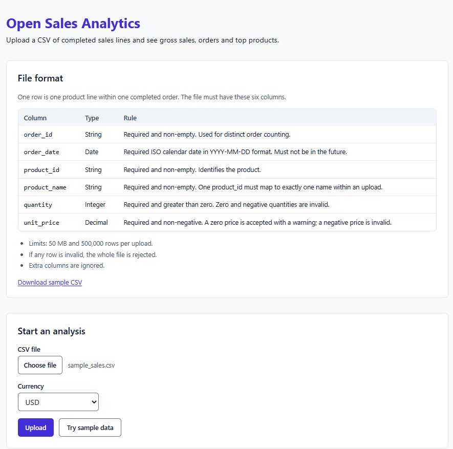
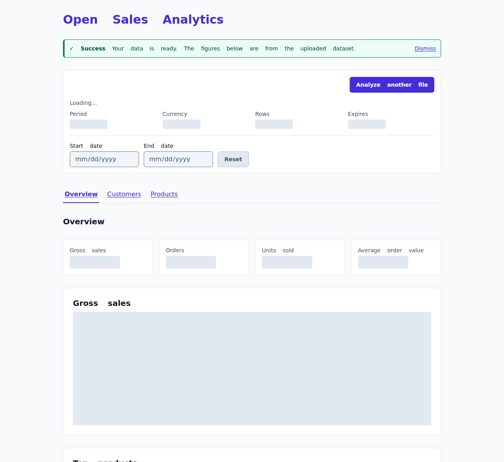
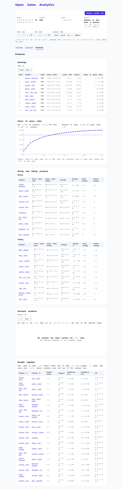
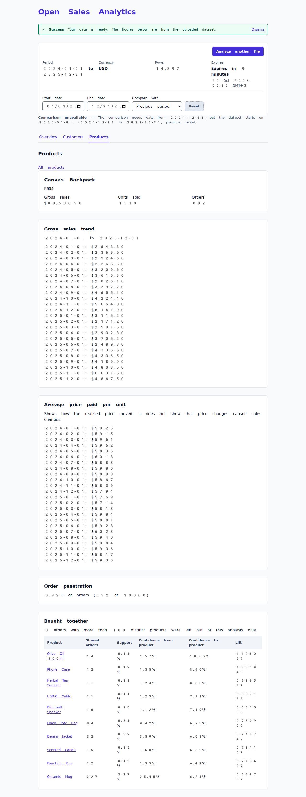
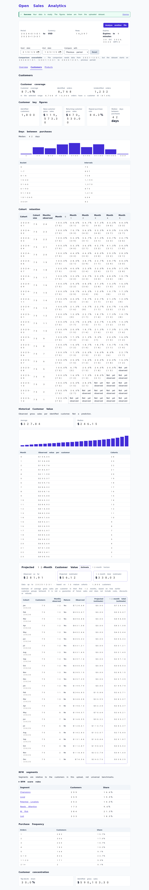

# open-sales-analytics

[English](README.md) | [Türkçe](README.tr-TR.md) | [Deutsch](README.de-DE.md) | [Русский](README.ru-RU.md) | [Español](README.es-ES.md) | [简体中文](README.zh-CN.md) | [日本語](README.ja-JP.md)

> Traducción del documento [en inglés](README.md), que es la fuente de referencia. Revisión de sincronización: `045796b0c7bbdd21520ccce1c7972495aab929f8`, con fecha `2026-10-22`.

Open Sales Analytics es una pequeña aplicación web autoalojada. Se carga un CSV con líneas de ventas completadas y
muestra las ventas brutas, los pedidos, las unidades, el valor medio del pedido, una tendencia de ventas y los
productos principales, con un intervalo de fechas modificable. Las ventas brutas son la suma de cantidad por precio
unitario de las líneas del periodo elegido. No incluyen devoluciones, descuentos, impuestos ni envíos.

Contenido: [Ejecutar con Docker](#ejecutar-con-docker) | [Configuración](#configuración) |
[Recorrido de demostración](#recorrido-de-demostración) | [Explorar los resultados](#6-explorar-los-resultados) |
[Análisis de productos](#análisis-de-productos) | [Análisis de clientes](#análisis-de-clientes) |
[Comparaciones](#comparaciones) | [Contrato del conjunto de datos](#contrato-del-conjunto-de-datos) |
[Monedas](#monedas) | [Privacidad](#privacidad) | [Modo de demostración](#modo-de-demostración) |
[Limitaciones](#limitaciones) | [Hoja de ruta](#hoja-de-ruta) | [Arquitectura](#arquitectura) |
[Desarrollo](#desarrollo) | [Cómo contribuir](#cómo-contribuir) | [Licencia](#licencia)

## Ejecutar con Docker

No hay una imagen publicada, así que debe compilarla una vez desde una copia de este repositorio y ejecutarla:

```sh
docker build -t open-sales-analytics .
docker run -p 8000:8000 open-sales-analytics
```

Abra <http://localhost:8000>. Verá la pantalla de carga; **Probar datos de ejemplo** abre un panel con el archivo de ejemplo.
`curl http://localhost:8000/api/health` devuelve `{"status":"ok"}`.

El contenedor se ejecuta con un usuario sin privilegios (UID 10001) y guarda los conjuntos de datos en `/data`
(`DATASET_DIR=/data`). Sin un volumen, se pierden al eliminar el contenedor. Para conservarlos, monte un volumen con
nombre en `/data`:

```sh
docker run -p 8000:8000 -v osa-data:/data open-sales-analytics
```

Con el volumen, los conjuntos sobreviven a `docker restart` y a la recreación del contenedor según lo permita el
sistema, y cada uno sigue caducando tras `DATASET_TTL_HOURS`. Si monta un directorio del host en `/data` en vez de un
volumen con nombre, debe permitir la escritura al usuario sin privilegios del contenedor (UID 10001), por ejemplo
`sudo chown 10001 /path/to/dir`.

La imagen se comprueba a sí misma: `docker ps` muestra `healthy` unos segundos después de arrancar y `unhealthy` cuando
`/api/health` deja de responder (cada 10 s, espera de 3 s, 3 fallos y periodo inicial de 10 s). `docker stop` termina el
servidor en menos de un segundo con código 0, después de detener la limpieza en segundo plano. El servidor no establece
su propio tiempo límite de solicitud (se aplican los valores de uvicorn), por lo que una carga muy lenta solo termina
cuando el cliente deja de esperar.

Pase un ajuste con `-e` usando una variable de la [tabla siguiente](#configuración):

```sh
docker run -p 8000:8000 -e PUBLIC_DEMO_MODE=true open-sales-analytics
```

## Recorrido de demostración

Un recorrido paso a paso con datos de ejemplo generados, desde una copia nueva hasta el panel.
El paso 1 necesita [uv](https://docs.astral.sh/uv/); el resto solo necesita Docker.

### 1. Generar los datos de ejemplo

```bash
uv run python backend/scripts/generate_sample.py
```

Esto escribe `backend/app/sample/sample_sales.csv`. La semilla hace que el archivo sea determinista, por lo que todos
obtienen los mismos datos y las mismas cifras del paso 6. Ejecútelo antes de `docker build`: el archivo se copia en la imagen.

Compruebe las primeras líneas:

```bash
head -n 4 backend/app/sample/sample_sales.csv
```

```
order_id,order_date,product_id,product_name,quantity,unit_price,customer_id
ORD-000001,2024-01-01,P001,Ceramic Mug,1,12.00,CUST-6ebe7ed43ba4
ORD-000001,2024-01-01,P002,Travel Tumbler,1,24.00,CUST-6ebe7ed43ba4
ORD-000002,2024-01-01,P001,Ceramic Mug,1,12.00,CUST-c4da5c3ce3f2
```

### 2. Compilar la imagen

```bash
docker build -t open-sales-analytics .
```

### 3. Ejecutar el contenedor

```bash
docker run -p 8000:8000 open-sales-analytics
```

El servidor está listo cuando el registro muestra `Uvicorn running on http://0.0.0.0:8000`.

### 4. Abrir la interfaz web

Abra <http://localhost:8000>. La pantalla de carga muestra el formato de archivo y el formulario.

### 5. Cargar los datos de ejemplo

Elija `backend/app/sample/sample_sales.csv`, seleccione **USD** y pulse **Subir**.
(**Probar datos de ejemplo** importa el mismo archivo sin seleccionarlo).



### 6. Explorar los resultados

El panel se abre en **Resumen** con todo el periodo de los datos, de 2024-01-01 a 2025-12-31:

| Métrica | Valor esperado |
| --- | --- |
| Filas | 14,397 |
| Ventas brutas | $675,816.70 |
| Pedidos | 10,000 |
| Unidades vendidas | 24,380 |
| Valor medio del pedido | $67.58 |



El periodo completo abarca 24 meses, así que la tendencia es mensual (consulte
[Intervalos de tendencia](#intervalos-de-tendencia)). Cambie **Fecha de inicio** y **Fecha de fin** para filtrar todas las cifras;
**Restablecer** restaura el periodo completo. **Comparar con** añade el periodo anterior o el mismo periodo del año anterior;
no está disponible para todo el periodo porque los datos comienzan el 2024-01-01.

**Productos** muestra las clasificaciones, la cuota de ventas brutas con su gráfico de Pareto acumulado, productos al
alza y a la baja, productos inactivos y productos comprados juntos, aquí para 2025 frente a 2024
(consulte [Análisis de productos](#análisis-de-productos)):



El nombre de un producto abre su detalle: tendencia de ventas brutas, precio medio pagado por unidad, penetración en
pedidos y productos comprados con él.



**Clientes** muestra la cobertura, cifras clave de clientes, días entre compras, mapa de calor de retención de cohortes,
valor histórico del cliente, valor proyectado del cliente a 12 meses, segmentos RFM, frecuencia de compra y concentración
(consulte [Análisis de clientes](#análisis-de-clientes)):



**Analizar otro archivo** elimina este conjunto de datos y vuelve a la pantalla de carga.

## Comparaciones

La tarjeta del intervalo puede comparar el intervalo activo con el periodo anterior o el mismo periodo del año pasado.
El panel muestra las fechas exactas devueltas por la API. Una comparación de todo el intervalo no está disponible cuando
empezaría antes de la primera fecha del conjunto. Las comparaciones de un día bisiesto usan el último día válido de
febrero del año comparado. Si no hay valor anterior se muestra “Sin valor anterior”; dos ceros son “Sin cambios”; un producto
nuevo es “Nuevo”; en los demás casos el porcentaje se muestra como “Comparable”.

## Análisis de productos

Todas las cifras de producto usan el intervalo activo inclusivo seleccionado salvo que se indique lo contrario. El
importe es ventas brutas: descuentos, devoluciones y costes quedan fuera del contrato. Cada nombre e ID de producto se
muestra como texto proporcionado por el servidor.

| Etiqueta de UI y clave | Fórmula y denominador | Ventana y estados no normales | Ejemplo |
| --- | --- | --- | --- |
| Clasificaciones — `gross_sales` | Suma de quantity × unit price; unidades vendidas es suma de quantity; pedidos es recuento distinto | Intervalo activo; los intervalos vacíos no tienen productos | Una línea con 2 unidades a 12.50 aporta 25.00 de ventas brutas |
| Cuota de ventas brutas — `gross_sales_share` | Ventas brutas del producto / ventas brutas totales | Intervalo activo; insuficiente si el total es cero | 15 de 100 es 15.00% |
| Cuota del 20% superior — `top_20_percent_share` | Ventas brutas del 20% superior por número de productos / total | Intervalo activo; insuficiente si el total es cero | Cinco productos 50/20/15/10/5: el primero es 50.00% |
| Productos para alcanzar el 80% — `products_to_80_percent` | Menor número ordenado cuya cuota acumulada alcanza el 80% | Intervalo activo; insuficiente si el total es cero | 50+20+15 alcanza el 80% con 3 productos |
| Cuota acumulada — `cumulative_share` | Ventas brutas acumuladas / ventas brutas totales | Intervalo activo; no disponible si el total es cero | Los tres primeros productos del ejemplo alcanzan 85.00% |
| Crecimiento del producto — `product_growth` | Ventas actuales menos ventas de comparación; el porcentaje usa el valor comparado | Periodo comparado; `Nuevo`, `Sin ventas actuales`, `Sin cambios` o comparación no disponible evitan porcentajes engañosos | De 10 a 20 es +10 y +100.00% |
| Clasificación al alza/a la baja — `rising_products`, `falling_products` | Orden por variación absoluta de ventas brutas | Comparación seleccionada; no disponible si la comparación no lo está | Un cambio de +10 supera a un +900% cuyo cambio es +1 |
| Productos inactivos — `dormancy` | Sin venta en la ventana elegida de 30, 60 o 90 días; los totales anteriores usan ventas previas a la ventana | Anclado al final del intervalo (última fecha para el intervalo completo), 60 por defecto; historial insuficiente y resultado cero son distintos. Una venta exactamente N días antes queda dentro | Un producto vendido por última vez 60 días antes se incluye en una ventana de 60 días |
| Precio unitario ponderado — `weighted_unit_price` | SUM(quantity × unit price) / SUM(quantity) | Intervalos activos; los intervalos sin ventas son huecos, no precios cero | 1 unidad a 10 y 3 a 20 da 17.50 |
| Penetración en pedidos — `order_penetration` | Pedidos distintos con el producto / todos los pedidos distintos | Intervalo activo; cero pedidos es resultado cero | 25 de 200 pedidos es 12.50% |
| Soporte — `basket_support` | Pedidos compartidos / pedidos de cesta aptos | Intervalo activo; se exigen 10 pedidos compartidos y 0.1% de soporte | 10 en 10,000 da 0.10% |
| Confianza — `basket_confidence` | Pedidos compartidos / pedidos con el producto direccional | Intervalo activo; no se muestran pares bajo el umbral | A→B y B→A pueden diferir por sus recuentos |
| Lift — `basket_lift` | Confianza / soporte del producto de destino | Intervalo activo; no se muestran pares bajo el umbral | Compara la tasa observada del par con el soporte de destino |

El registro compartido etiqueta estas claves como: Gross-sales share, Cumulative gross-sales share, Top 20% product
share, Products to 80% of gross sales, Product gross-sales growth, Rising products, Falling products, Dormant products,
Weighted realized unit price, Order penetration, Basket support, Basket confidence y Basket lift.

Los pares bajo cualquiera de los umbrales no se muestran aunque su lift sea alto. Los pedidos con más de 100 productos
distintos solo se excluyen del análisis de cesta; exactamente 100 sí se incluye y esos pedidos siguen contando en
clasificaciones, penetración y ventas brutas. Products indica cuántos se excluyeron. El historial de precios solo
describe el movimiento del precio realizado; no mide elasticidad ni demuestra causalidad. Las subidas y bajadas usan
variación absoluta para que las bases minúsculas no dominen. Penetración, soporte, confianza y lift usan pedidos distintos.

La documentación de la API está en [`/docs`](http://localhost:8000/docs). `GET /api/datasets/{id}/overview` devuelve KPI
y tendencias; `GET /api/datasets/{id}/products` devuelve análisis de cartera; y
`GET /api/datasets/{id}/products/detail?product_id=...` devuelve el detalle de un producto. Los endpoints de conjuntos
requieren el token bearer.

## Análisis de clientes

El análisis de clientes solo contiene agregados. Describe pedidos identificados y nunca muestra un identificador, una
lista ni una cantidad por cliente. El intervalo activo incluye ambas fechas salvo que una fila se describa explícitamente
como historial completo hasta el final seleccionado. Los ejemplos usan
`backend/tests/fixtures/customers/golden_customers.csv`: 20 pedidos, 19 identificados, 10 clientes y 380.0000 de ventas
brutas identificadas entre 2025-01-01 y 2025-09-30.

| Etiqueta de UI y clave | Fórmula, ventana y ancla | Datos insuficientes y resultado cero | Ejemplo |
| --- | --- | --- | --- |
| Cobertura de clientes — `customer_coverage` | Pedidos identificados distintos / todos los pedidos distintos; por pedido para conjunto e intervalo | Sin `customer_id` no disponible, bajo 50% suprimido y sin pedidos cobertura null | 19 / 20 = 95.0% |
| Clientes identificados — `identified_customers` | Valores `customer_id` distintos con línea identificada en el intervalo inclusivo | Ninguno devuelve 0 con `zero_result` | El intervalo tiene 10 |
| Ventas de nuevos frente a recurrentes — `new_vs_returning` | Divide `SUM(quantity × unit_price)` según sea la fecha del primer pedido del historial o posterior; historial hasta el final | Sin filas identificadas devuelve importes cero con `zero_result` | La compra de CUST-01 del 2024-12-15 hace recurrentes sus ventas de 2025 |
| Tasa de compra repetida — `repeat_purchase` | Clientes activos con al menos dos pedidos distintos hasta el final / clientes identificados activos; cuentan pedidos previos al inicio | Sin clientes activos es `insufficient_data`; sin repetición es exactamente 0 (`zero_result`) | Pedidos del mismo día son pedidos distintos |
| Días entre compras — `days_between_purchases` | Mediana de días naturales entre pedidos distintos consecutivos; cuenta si el posterior está en el intervalo, el mismo día da 0 | Sin intervalo: mediana null y `insufficient_data`; tramos 0, 1-7, 8-14, 15-30, 31-60, 61-90, 91-180, 181-365 y 366+ | Una pareja del mismo día va al tramo 0 |
| Retención de cohortes — `cohort_retention` | Clientes retenidos / tamaño de cohorte de todo el historial, por desfase mensual; usa historial hasta el final | Cohortes ausentes: `insufficient_data`; una celda del borde es `Aún no observado`, nunca 0% | Mes 0 es 100.0% |
| Valor histórico del cliente — `historical_customer_value` | Ventas identificadas observadas hasta el final / clientes identificados; mediana del valor por cliente; curvas acumuladas | Sin cohorte: `insufficient_data`; ventas cero es resultado cero; observado, no predicción | 380.0000 entre 10 clientes |
| Segmentos RFM — `rfm` | Recencia en días antes del final; frecuencia en pedidos distintos; importe en ventas brutas. Quintiles relativos y FM = F + M | Menos de 5 clientes: `insufficient_data`; empates reciben la misma puntuación y la tabla completa está en el registro | Relativo a esta carga, no referencia universal |
| Desgloses RFM — `rfm_drilldown` | Ventas agregadas y tramos de recencia (0-30 a 366+) y frecuencia (1, 2, 3, 4, 5, 6-10, 11-20, 21+); sin filas por cliente | Menos de 5: `insufficient_data`; ventas cero tienen cuota null | El fixture incluye empates sin desempate por ID |
| Frecuencia de compra — `purchase_frequency` | Clientes por pedidos identificados distintos hasta el final: 1, 2, 3, 4, 5, 6-10, 11-20 y 21+ | Sin clientes: recuentos vacíos, cuotas null y `insufficient_data` | Dos pedidos pertenece al tramo 2 |
| Concentración — `concentration` | Ventas del decil superior / ventas identificadas; para N, el grupo tiene los `ceil(N / 10)` mayores valores sin desempate en el corte | Menos de 10 o ventas cero: `insufficient_data` y cuota null | N=10, 1000, 500 y ocho 100: 1000 / 2300 = 0.4348 |

Los niveles de cobertura 50% y 80% son inclusivos: menos del 50% se oculta; de 50.0% hasta antes de 80% muestra una
advertencia; 80% o más es normal. La UI trunca a un decimal, sin redondear a través del límite. Se calcula por pedido,
no por línea. Un archivo sin la columna no está disponible en vez de ser 0%.

La identidad y las cohortes usan todo el historial hasta el final. Retrasar el inicio no reclasifica a un cliente ni
cambia su cohorte. La recencia RFM y la madurez se anclan al final, nunca a hoy. Una celda parcial o futura es
**Aún no observado**, no un cero.

Las reglas de coherencia son exactas: los blancos de un pedido se rellenan desde su único ID no vacío; dos ID distintos
rechazan toda la carga; un pedido enteramente vacío sigue sin identificar. El límite predeterminado de `customer_id` es
128 caracteres. Las comprobaciones de mejor esfuerzo rechazan correos, teléfonos obvios y valores demasiado largos;
no detectan nombres, direcciones, documentos nacionales, codificaciones reversibles ni formatos telefónicos inusuales.

Los datos de clientes son seudónimos, no anónimos. Use UUID, clave interna o hash con sal secreta fuera del archivo.
Las respuestas solo contienen recuentos y sumas agregados: no hay lista, búsqueda, descarga ni exportación y no se
registran ID, cohortes ni registros RFM. Los datos solo residen en el DuckDB del conjunto y se eliminan tras
`DATASET_TTL_HOURS` (24 por defecto) o inmediatamente con **Analizar otro archivo**; el CSV original se elimina tras la
importación. El valor proyectado a 12 meses es otra métrica futura, no esta medida observada.

## Configuración

El servidor lee estas variables de entorno al iniciarse. Todas son opcionales.

| Variable | Tipo | Predeterminado | Efecto |
| --- | --- | --- | --- |
| `DATASET_DIR` | path | `./tmp_datasets` (`/data` en la imagen Docker) | Directorio con un DuckDB por conjunto. Se crea con permisos privados si falta. |
| `DATASET_TTL_HOURS` | integer > 0 | `24` | Horas tras las que caduca y se elimina un conjunto. |
| `DATASET_TTL_SECONDS` | integer > 0 | unset | Solo pruebas. Vida en segundos en lugar de `DATASET_TTL_HOURS`. Las pruebas de navegador lo usan para una caducidad real. No lo establezca en producción. |
| `MAX_UPLOAD_BYTES` | integer > 0 | `52428800` (50 MB) | Mayor carga aceptada en bytes. Un archivo mayor se rechaza con `file_too_large`. |
| `MAX_ROWS` | integer > 0 | `500000` | Máximo de filas de datos (sin cabecera). Más se rechaza con `too_many_rows`. |
| `CUSTOMER_ID_MAX_LENGTH` | integer > 0 | `128` | Máximo de caracteres Unicode para `customer_id` no vacío; más se rechaza con `customer_id_too_long`. |
| `CLEANUP_INTERVAL_MINUTES` | integer > 0 | `15` | Frecuencia con la que se eliminan conjuntos caducados (también al arrancar). |
| `PUBLIC_DEMO_MODE` | boolean | `false` | `true` desactiva las cargas; consulte [Modo de demostración](#modo-de-demostración). |
| `MAX_DATASETS` | integer > 0 | `200` | Máximo de conjuntos vigentes. Crear otro responde 503 `capacity_reached` hasta que caduque o se elimine uno. |
| `RESPONSE_CACHE_MAX_ENTRIES` | integer >= 0 | `256` | Máximo de respuestas Overview/Product en caché en este proceso. `0` desactiva la caché. |
| `RESPONSE_CACHE_TTL_SECONDS` | integer > 0 | `300` | Vida máxima de una respuesta Overview/Product en caché; la caducidad del conjunto prevalece. |

Los booleanos aceptan `true`/`false`, `1`/`0` y `yes`/`no` sin distinguir mayúsculas (también `on`/`off`,
`t`/`f` y `y`/`n`).

Un valor no válido impide el arranque y el error nombra la variable. Es inválido no ser número, ser cero o negativo,
un decimal como `1.5`, una cadena vacía o un booleano distinto de los anteriores. Por ejemplo,
`MAX_ROWS=0 uv run uvicorn app.main:app --app-dir backend` termina con `MAX_ROWS  Input should be greater than 0`.

## Contrato del conjunto de datos

Cada fila es una línea de producto de un pedido completado. El archivo debe tener las seis columnas obligatorias y una
opcional (la misma tabla aparece en la carga). Consulte [Análisis de clientes](#análisis-de-clientes) para el significado
y los límites de privacidad de `customer_id`:

| Columna | Tipo | Regla |
| --- | --- | --- |
| `order_id` | String | Obligatoria y no vacía. Se usa para contar pedidos distintos. |
| `order_date` | Date | Fecha ISO obligatoria `YYYY-MM-DD`. No puede estar en el futuro. |
| `product_id` | String | Obligatoria y no vacía. Identifica el producto. |
| `product_name` | String | Obligatoria y no vacía. Un `product_id` debe corresponder a un solo nombre en la carga. |
| `quantity` | Integer | Obligatoria y mayor que cero. Cero y negativos no son válidos. |
| `unit_price` | Decimal | Obligatorio y no negativo. Cero se acepta con advertencia; negativo no es válido. |
| `customer_id` | String | Opcional. Puede estar vacío; hasta `CUSTOMER_ID_MAX_LENGTH` caracteres Unicode (128 por defecto); use hash, UUID o clave interna no personal. Nunca correo, teléfono, nombre u otro identificador directo. |

Reglas del archivo:

- UTF-8, separado por comas y una cabecera. La cabecera es la fila 1 en los errores y los datos empiezan en la 2.
- Los nombres se comparan tras recortar espacios; el orden no importa. Una columna ajena a las seis obligatorias o
  `customer_id` se ignora con una advertencia (`extra_column`).
- `(order_id, product_id)` es único: un producto aparece como máximo una vez por pedido.
- Un solo nombre por `product_id` en todo el archivo.
- En un pedido, los `customer_id` vacíos se rellenan con su único ID no vacío; los ID en conflicto rechazan la carga
  y los pedidos enteramente vacíos siguen sin identificar.
- Una moneda por carga, elegida en el formulario (consulte [Monedas](#monedas)).
- Cualquier fila inválida rechaza todo el archivo. No se almacena nada.
- Máximo predeterminado de 50 MB y 500,000 filas (`MAX_UPLOAD_BYTES` y `MAX_ROWS`).
- Las cantidades son enteros hasta 2,147,483,647. Los precios son decimales simples (sin símbolo ni separador de miles)
  con hasta 14 dígitos antes y 4 después del punto.

### Ejemplo válido

Guárdelo como `example.csv`. Tiene tres líneas y dos pedidos; `A-1001` tiene dos líneas.

```csv
order_id,order_date,product_id,product_name,quantity,unit_price
A-1001,2025-03-01,P-10,Ceramic Mug,2,12.50
A-1001,2025-03-01,P-20,Travel Tumbler,1,24.00
A-1002,2025-03-02,P-10,Ceramic Mug,1,12.50
```

Puede incluir `customer_id`; se permiten celdas vacías:

```csv
order_id,order_date,product_id,product_name,quantity,unit_price,customer_id
A-1001,2025-03-01,P-10,Ceramic Mug,2,12.50,CUST-007
A-1001,2025-03-01,P-20,Travel Tumbler,1,24.00,
```

Con la aplicación en el puerto 8000, impórtelo por la API:

```sh
curl -F currency=USD -F file=@example.csv http://localhost:8000/api/datasets
```

La respuesta es `201` con `"warnings":[]`, `dataset_id`, `token` y el primer resumen. Las ventas brutas son 61.50 de
2 pedidos y 4 unidades.

### Ejemplos no válidos

Cada uno es un pequeño cambio al archivo válido. La aplicación responde `422` con `validation_failed` y una lista;
el `code` de cada error figura en la tabla. También incluye fila y columna.

| Cambio | `code` de error | Fila |
| --- | --- | --- |
| Quitar `unit_price` de la cabecera y el último valor de cada fila | `missing_column` | ninguna (archivo) |
| Cambiar `2025-03-02` a `2025-13-02` | `invalid_date` | 4 |
| Cambiar la última cantidad de `1` a `0` | `invalid_quantity` | 4 |
| Repetir la última fila | `duplicate_line` | 5 |

### Códigos de error

El informe enumera los primeros 100 y da el total (`error_count`).

| Código | Causa |
| --- | --- |
| `file_too_large` | El archivo supera `MAX_UPLOAD_BYTES`. |
| `empty_file` | El archivo está vacío. |
| `invalid_encoding` | No es UTF-8 válido. |
| `malformed_csv` | No se puede leer como CSV (por ejemplo, un campo supera 131,072 caracteres). |
| `too_many_rows` | Más de `MAX_ROWS` filas de datos. |
| `no_data_rows` | Hay cabecera pero no datos. |
| `missing_column` | Falta una de las seis columnas obligatorias. |
| `duplicate_column` | Una columna obligatoria aparece más de una vez. |
| `missing_value` | Un valor obligatorio está vacío. |
| `invalid_date` | `order_date` no es una fecha real `YYYY-MM-DD`. |
| `future_date` | `order_date` es posterior a hoy (UTC). |
| `invalid_quantity` | `quantity` no es un entero entre 1 y 2,147,483,647. |
| `invalid_price` | `unit_price` no es un decimal simple con hasta 14 dígitos antes y 4 después del punto. |
| `negative_price` | `unit_price` es menor que cero. |
| `line_total_too_large` | `quantity × unit_price` es 100,000,000,000,000 o más, fuera del rango decimal exacto. |
| `malformed_row` | La fila tiene distinto número de valores que la cabecera. |
| `duplicate_line` | Los mismos `order_id` y `product_id` aparecieron antes. |
| `conflicting_product_name` | Un `product_id` tiene más de un `product_name`. |
| `conflicting_customer_id` | Un pedido tiene más de un `customer_id` no vacío. |
| `customer_id_too_long` | Un `customer_id` supera `CUSTOMER_ID_MAX_LENGTH` caracteres Unicode. |
| `customer_id_looks_like_email` | Un `customer_id` coincide con la heurística obvia de correo. |
| `customer_id_looks_like_phone` | Un `customer_id` coincide con la heurística obvia de teléfono. |

Las tres comprobaciones de `customer_id` son defensas de mejor esfuerzo, no anonimización ni garantía de cumplimiento.
La de correo busca `[^@\s]+@[^@\s]+\.[A-Za-z]{2,}` en cualquier parte. La de teléfono exige solo dígitos, espacios,
`+ - . ( )`, entre 7 y 15 dígitos y además un `+` inicial, espacios/paréntesis visibles o al menos dos separadores
`-`/`.`. Tienen omisiones conocidas: `05321234567` se acepta y `2024-01-000123` se rechaza. Un ID aceptado no es
por ello anónimo.

Una solicitud también puede fallar antes de leer el archivo: una moneda fuera de la lista responde `400 invalid_request`.

### Cobertura de clientes

Si existe `customer_id`, la cobertura se calcula una vez al importar, por pedido y después de rellenar ID vacíos:

`identified distinct orders / all distinct orders`

No es un porcentaje de filas: un pedido identificado de cinco líneas cuenta una vez. Los metadatos informan recuentos
y proporción redondeada; el nivel usa recuentos enteros exactos de todo el conjunto:

- menos de 50%: `suppressed`; análisis de clientes no disponible;
- de 50% hasta menos de 80%: `warning`; disponible con advertencia;
- 80% o más: `normal`; disponible normalmente.

Los archivos sin `customer_id` tienen nivel `missing` y `coverage: null`, no cobertura cero. Los metadatos solo contienen
recuentos, nunca ID. La cobertura por fechas usa la misma fórmula inclusiva; un intervalo vacío tiene recuentos cero y
`coverage: null`. El nivel sigue basándose en todo el conjunto, así que filtrar fechas no oculta ni muestra Customers.

### API de clientes

`GET /api/datasets/{id}/customers` está protegido por bearer y acepta `start`, `end` y `comparison` como Overview y
Products. Sin parámetros usa todo el conjunto y `previous_period`. Fechas inválidas, invertidas o fuera del rango
devuelven `400 invalid_range`; comparación desconocida, `400 invalid_request`. Credenciales ausentes o mal formadas
dan `401 unauthorized` con `WWW-Authenticate: Bearer`; conjunto desconocido, caducado o eliminado, `404 not_found`.

La respuesta tipada contiene `module`, `range`, `comparison`, `currency`, `availability`, `coverage` y `sections`.
`coverage.dataset` es la cobertura guardada de todo el conjunto y `coverage.range` la del intervalo inclusivo; ambas
incluyen nivel, proporción redondeada y pedidos identificados, no identificados y totales. Con cobertura normal o de
advertencia, `sections.identified_customers` informa clientes distintos activos y campos comunes de comparación y cambio.
Una población vacía es `zero_result`. `sections.new_vs_returning` separa las ventas identificadas entre nuevos (líneas
de la primera fecha de compra) y recurrentes (posteriores), con los mismos campos; siempre usa `first_order_date` del
historial completo, así que mover el inicio no convierte a un recurrente en nuevo.

`sections.days_between_purchases` informa del tiempo entre pedidos solo para el intervalo actual, sin comparación.
Los pedidos distintos de cada cliente se fechan por su primera línea y se ordenan; cada par consecutivo es un intervalo
en días, y dos pedidos el mismo día dan `0`. Cuenta si el pedido posterior está dentro, aunque el anterior sea previo al
inicio; se ignoran pedidos posteriores al final. Devuelve `median_days` (media de los dos valores centrales si el número
es par, por lo que puede acabar en `.5`; no se informa de la media general), `interval_count`,
`contributing_customers` y nueve `buckets` fijos (`0`, `1-7`, `8-14`, `15-30`, `31-60`, `61-90`, `91-180`,
`181-365`, `366+` días), con `interval_count` y `share`. Sin intervalos, mediana y cuotas son `null` y el estado
`insufficient_data`.

`sections.cohort_retention` es una matriz mensual de retención solo para el intervalo actual, sin comparación. La cohorte
es el mes del primer pedido de todo el historial; las filas abarcan de los meses del inicio al final, de más antigua a
más nueva, por lo que mover solo el inicio no cambia una fila. El final es `data_cutoff`: clientes vistos por primera
vez después no son miembros y se ignora actividad posterior; la actividad anterior al inicio sí cuenta. Cada fila tiene
`cohort_month` (`YYYY-MM`), `cohort_size`, `complete_months` y `cells`; el mes `N` (0 = adquisición) contiene
`retained_count` y `retention` (`retained_count / cohort_size`). Su `state` es `complete` (mes entero anterior al corte),
`partial` (contiene el corte) o `not_observed` (empieza después; valores `null`, nunca `0`). Se rellenan las filas hasta
la anchura de la cohorte más antigua. Sin cohorte solapada, `rows` está vacío y el estado es `insufficient_data`.

`sections.historical_customer_value` informa del valor histórico observado, no pronóstico, para el intervalo actual.
Su población son los miembros de las filas `cohort_retention` de `sections.cohort_retention`; el valor incluye ventas
identificadas hasta `data_cutoff`, incluso antes del inicio. Devuelve `customer_count`, `average` (total / `customer_count`)
y `median` (media de los dos centrales
si es par), redondeados half-up a 4 decimales. `rows` replica cohortes y estados; `value_per_customer` es la venta
acumulada hasta el mes `N` limitada por el corte / `cohort_size` (`null` para `not_observed`). Las filas reflejan
`cohort_retention`. `all_cohorts` tiene un
punto por desfase para cohortes `complete` (`value_per_customer`, `contributing_cohorts`; `null` y `0` si ninguna).
Sin cohorte es `insufficient_data`; valor total `0` produce `zero_result` con `0.0000`.

`sections.rfm` informa segmentos RFM actuales sin comparación. Su población (`customer_count`, N) son clientes con
pedido identificado hasta el final; cuenta toda su actividad hasta allí y el inicio no afecta. Recencia son días desde
la última línea hasta `recency_anchor`, frecuencia pedidos distintos e importe ventas brutas. Cada dimensión puntúa 1-5:
`floor(5 × (2 × worse + ties) / (2 × N)) + 1`, donde `worse` cuenta valores estrictamente peores y `ties` iguales;
los empates puntúan igual y una dimensión constante puntúa 3. Con `FM = F + M`, la primera regla nombra el segmento:
Champions (R ≥ 4, FM ≥ 8), Loyal (R ≥ 3, FM ≥ 6), Potential Loyalists (R ≥ 4, FM ≤ 5), Needs Attention
(R = 3, FM ≤ 5), At Risk (R ≤ 2, FM ≥ 6), Lost (R ≤ 2, FM ≤ 5). `segments` enumera los seis en ese orden con
`customer_count` y `share`; las puntuaciones individuales no salen del backend. Menos de 5 da `segments` vacío y
`insufficient_data`. Una `note` fija aclara que son relativos a esta carga, no referencias universales.

`sections.rfm_drilldown` informa agregados por segmento con la misma población, entradas y segmentos que `sections.rfm`,
sin comparación. Devuelve `customer_count`, `recency_anchor` y `gross_sales` total, redondeado half-up a 4 decimales.
Como en `sections.rfm`, cada uno de los seis
`segments` contiene `customer_count`, `gross_sales` y `gross_sales_share` (`gross_sales` del segmento /
`gross_sales` del nivel superior; `null` si el total es 0),
`recency_distribution` en `0-30`, `31-60`, `61-90`, `91-180`, `181-365` y `366+` (`key`, `min_days`,
`max_days`, `customer_count`), y `frequency_distribution` en `1`, `2`, `3`, `4`, `5`, `6-10`, `11-20` y
`21+` (`key`, `min_orders`, `max_orders`, `customer_count`). Los máximos abiertos son `null` y los vacíos, `0`.
Un segmento de un miembro se informa normalmente porque no devuelve ID ni puntuación. Menos de 5 da `insufficient_data`
con `customer_count` y `gross_sales` reales y `segments` vacío, igual que `sections.rfm`.

La cobertura ausente o suprimida omite todas las secciones (`sections` vacío). El endpoint siempre devuelve
`Cache-Control: no-store`. Las respuestas son solo agregados: nunca ID, objetos de cliente, búsqueda, detalle, descarga
o exportación, y no se escriben identificadores en los registros.

### Advertencias

No rechazan el archivo; aparecen en `warnings` de la respuesta `201` y en la pantalla.

| Código | Significado |
| --- | --- |
| `extra_column` | Columna ajena a las seis obligatorias o `customer_id`, por ejemplo `note`. Se ignora y no se almacena. |
| `zero_price` | Una o más líneas tienen precio 0. Se importan y cuentan como pedidos y unidades, sin ventas brutas. |

### Datos de ejemplo

Descargue un archivo válido en <http://localhost:8000/api/sample.csv> (en la pantalla, **Descargar CSV de ejemplo**).
**Probar datos de ejemplo** importa el mismo archivo en USD sin carga.

## Intervalos de tendencia

La tendencia agrupa ventas brutas por intervalo natural. La granularidad solo depende del rango inclusivo: hasta 90
días es diaria, más de 90 hasta 730 semanal y más larga mensual. La API devuelve `bucket_start` (primer día) sin cobertura.

- El intervalo incluye inicio y final.
- Las semanas van de lunes a domingo y `bucket_start` es lunes. Los meses son naturales.
- Un intervalo cortado (primera semana/mes comienza antes del inicio o el último termina después del final) es parcial.
  El gráfico lo calcula por calendario, de modo que un día sin ventas también está cubierto. Un día diario siempre es
  completo; un corte de un día de semana o mes es parcial. Un rango dentro de una sola semana o mes lo muestra parcial.
- La etiqueta parcial muestra las fechas cubiertas (`29–31 dic`, `10–31 mar 2025`) en lugar de `Semana del 29 dic` o
  el mes; el punto es hueco, hay una nota y el tooltip añade el año y `Período parcial: <fechas cubiertas>`. Un intervalo
  completo no muestra nada de esto.
- Solo se suman filas dentro del rango, por lo que el intervalo parcial contiene ventas de las fechas cubiertas.

## Monedas

Se elige en la carga: USD, EUR, GBP, TRY, CAD, AUD, JPY, CHF, SEK, PLN. Solo etiqueta los importes; no hay conversión
ni tipo de cambio. Cualquier otro código se rechaza con `400 invalid_request`.

## Privacidad

- El CSV original se elimina en cuanto termina la importación, tanto si tiene éxito como si falla.
- Las columnas obligatorias y `customer_id` se guardan en un DuckDB por conjunto bajo `DATASET_DIR`, con permisos
  privados (`0600` para el archivo, `0700` para directorios).
- Los ID de clientes son datos seudónimos, no anónimos, y se conservan durante las 24 horas del conjunto. Use un hash,
  UUID o clave interna no personal; nunca cargue correo, teléfono, nombre u otro identificador directo.
- Las comprobaciones de longitud, correo y teléfono son defensas de mejor esfuerzo, no anonimización ni garantía de
  cumplimiento; no pueden detectar todas las clases de datos personales.
- El conjunto se elimina tras `DATASET_TTL_HOURS` (24 por defecto) al arrancar y cada `CLEANUP_INTERVAL_MINUTES`,
  o inmediatamente al pulsar **Analizar otro archivo**.
- Las respuestas correctas pueden conservarse en una caché local al proceso durante `RESPONSE_CACHE_TTL_SECONDS`
  (300 segundos); cada solicitud se autoriza, las entradas se indexan por conjunto y opciones y se eliminan al caducar
  o borrar. La caché no se comparte entre instancias.
- El acceso requiere un token bearer aleatorio. El navegador lo guarda en `sessionStorage` y desaparece al cerrar la
  pestaña. El servidor solo conserva su hash SHA-256.
- Un ID ausente o caducado responde 404 y un token incorrecto para un ID existente, 401, revelando si el ID existe.
  Es un riesgo aceptado: los ID aleatorios de 128 bits no se pueden adivinar y sin token el conjunto no se puede leer.
- Los registros tienen una línea JSON por solicitud con método, ruta, estado, duración e ID del conjunto. El ID se
  registra deliberadamente para trazabilidad; no es secreto ni sirve sin token. Nunca incluyen tokens, contenido o
  nombres de archivo, nombres de productos ni ID de pedidos. Los errores contienen clases y marcos de pila, no mensajes.
- No se envía nada a otros servicios.
- Cuando hay ID, el DuckDB también contiene `customer_facts`: una fila por cliente identificado con fechas de primer y
  último pedido, mes de adquisición, pedidos, unidades y ventas brutas de toda la vida. No hay filas para pedidos no
  identificados, caduca con el conjunto y no es una base compartida aparte.

## Modo de demostración

Una demo alojada es una instancia pública con `PUBLIC_DEMO_MODE=true`: solo permite explorar los datos incluidos, sin
cargar archivos. Sus conjuntos caducan igual (`DATASET_TTL_SECONDS`) y usa una sola instancia. Para analizar sus
archivos, [ejecútela usted mismo](#ejecutar-con-docker).

`PUBLIC_DEMO_MODE=true` es para un servidor público que no debe aceptar archivos ajenos:

- `POST /api/datasets` responde 403 `upload_disabled` sin leer el cuerpo.
- **Probar datos de ejemplo** y la descarga siguen funcionando.
- La pantalla muestra el formato y **Probar datos de ejemplo**, sin campos de archivo o moneda. Indica que solo acepta el
  ejemplo y enlaza [Ejecutar con Docker](#ejecutar-con-docker) para cargas.
- `GET /api/config` devuelve `{"public_demo_mode":true,...}`, que informa a la pantalla.
- `MAX_DATASETS` protege el disco: cada clic crea un conjunto y, al llegar al máximo, responde 503 `capacity_reached`.

## Limitaciones

- Una sola instancia; no hay escalado horizontal, pues los conjuntos son archivos de su disco.
- Sobrevivir a un reinicio es de mejor esfuerzo y solo si `DATASET_DIR` está en un volumen.
- Sin cuentas ni uso compartido. Solo se accede con el token de una pestaña.
- Una moneda por archivo.
- Sin listas, exportaciones ni búsquedas de clientes; las cifras cubren pedidos identificados.
- Solo ventas brutas: sin devoluciones, descuentos, impuestos ni envíos.
- 50 MB y 500,000 filas por defecto.
- Anchuras de móvil, tableta y escritorio (desde 360 px); las tablas anchas se desplazan en su región
  (consulte [`_docs/design-system.md`](_docs/design-system.md)).

## Hoja de ruta

Phase 3 está completa. Los siguientes candidatos, según la
[especificación de Phase 3](_docs/open_sales_analytics_phase_3_spec.md#20-deferred-roadmap):

- **Fase 4: base de producto gestionado.** Base central, cuentas, propiedad, conjuntos guardados y paneles persistentes.
- **Fase 4: ingesta alojada.** Cargas públicas protegidas con límites, aislamiento, controles de abuso y supervisión.
- **Fase 4: capa de contrato financiero.** Columnas opcionales `discount_amount`, `refund_amount` y `unit_cost`, con
  ventas netas, descuentos, devoluciones y márgenes.
- **Más adelante:** adaptadores Shopify, WooCommerce y marketplaces; conjuntos multiarchivo y multicanal; activación y
  exportación de clientes con modelo explícito de privacidad; importaciones asíncronas mayores; pronóstico o detección
  de anomalías solo tras validar la necesidad.

## Arquitectura

Un frontend React (Vite) con Recharts intercambia JSON con FastAPI. Cada conjunto es un DuckDB bajo `DATASET_DIR`; la
validación y el análisis son SQL sobre él. La importación crea `order_facts`, `product_facts` y, si hay clientes,
`customer_facts` de historial completo. Una tarea local elimina conjuntos caducados. La imagen es un contenedor único:
FastAPI sirve API y frontend desde un origen en el puerto 8000. Consulte la
[guía de arquitectura de Phase 3](_docs/architecture.es-ES.md), el [catálogo de métricas](_docs/metrics.es-ES.md),
la [lista y evidencias de publicación](_docs/phase-3-release-checklist.md),
la [especificación de Phase 3](_docs/open_sales_analytics_phase_3_spec.md) y el [backlog](_docs/tasks.md).

## Desarrollo

Organización: [`_docs/process.md`](_docs/process.md). Convenciones de pruebas:
[`_docs/testing-guidelines.md`](_docs/testing-guidelines.md). Comandos y resultados de rendimiento:
[`_docs/benchmarks.md`](_docs/benchmarks.md).

Desde la raíz:

```sh
uv sync
uv run pytest
```

Lint y tipos (los mismos que CI; `uv sync` instala `ruff` y `mypy` como dependencias de desarrollo):

```sh
uv run ruff check backend
uv run ruff format --check backend   # `uv run ruff format backend` fixes it
uv run mypy backend/app
```

Escaneo de dependencias (las dos órdenes de `dependency-scan`; `uvx` ejecuta `pip-audit` sin añadir dependencia):

```sh
uv export --locked --no-emit-project --format requirements-txt -o /tmp/requirements.txt
uvx pip-audit@2.10.1 -r /tmp/requirements.txt --no-deps --disable-pip
(cd frontend && npm audit --audit-level=high)
```

Inicie el backend (http://127.0.0.1:8000):

```sh
uv run uvicorn app.main:app --app-dir backend
```

`curl http://127.0.0.1:8000/api/health` devuelve `{"status":"ok"}`. Para servir el frontend compilado desde el mismo
origen sin Docker, ejecute antes `npm run build` en `frontend/` y abra <http://127.0.0.1:8000>.

### Frontend

Requiere Node 22 o posterior. Desde `frontend/`:

```sh
npm ci            # install
npm run dev       # dev server on http://localhost:5173
npm test          # Vitest, single run
npm run lint      # ESLint
npm run typecheck # tsc --noEmit (TypeScript 7)
npm run build     # type check, then the production bundle in frontend/dist
```

`npm run dev` reenvía `/api` al backend del puerto 8000, así que inicie también el backend.

### Comprobaciones obligatorias de CI

La fusión en `main` debe exigir estas cuatro comprobaciones con el nombre exacto mostrado por GitHub (Settings,
Branches o Rules, “Require status checks to pass”):

- `Backend (tests, ruff, mypy)`
- `Frontend (tests, lint, type check, build)`
- `Dependency scan (Python, npm) / Dependency scan (Python, npm)`
- `Container (build, smoke, browser tests)`

El escaneo llama al workflow reutilizable `.github/workflows/dependency-scan.yml`, por lo que GitHub muestra dos veces
el nombre como `<calling job> / <called job>`. Seleccione el nombre doble completo; `Dependency scan (Python, npm)`
simple no coincide. Si cambia el nombre de un job en `.github/workflows/`, actualice esta lista y la protección en el
mismo cambio: una comprobación requerida inexistente bloquea todas las fusiones. Compare con `gh pr checks <number>`.

### Escaneo de dependencias

CI escanea ambos archivos de bloqueo en cada pull request y push a `main`, y los lunes a las 05:17 UTC
(`.github/workflows/dependency-scan-scheduled.yml`); una vulnerabilidad nueva vuelve rojo un archivo sin cambios. Ambos
llaman a `.github/workflows/dependency-scan.yml` y comparten órdenes y política. La ejecución programada tiene
`contents: read`, no secretos y también se inicia a mano en Actions (“Run workflow”).

| Ecosistema | Herramienta y entrada | Falla CI con |
| --- | --- | --- |
| Python | `pip-audit` sobre `uv.lock` (runtime y desarrollo) | cualquier vulnerabilidad conocida (sin filtro de gravedad) |
| npm | `npm audit --audit-level=high` sobre `frontend/package-lock.json` | avisos high y critical; low y moderate solo se muestran |

Un error del escáner también falla: no hay `|| true` ni `continue-on-error`. No hay lista de ignorados. Si no existe
solución, debe revisarse un pull request que incluya la excepción con ID y motivo (`pip-audit --ignore-vuln ID` o
eliminar el paquete), nunca omitirla en silencio. Las cachés solo contienen paquetes y el navegador Playwright; ningún
conjunto, carga, secreto o DuckDB se guarda ni sube como artefacto.

Dependabot (`.github/dependabot.yml`) abre los lunes pull requests para dependencias Python (`uv.lock` desde
`pyproject.toml`) y npm (`frontend/package-lock.json`), hasta 5 por ecosistema. Solo actualiza dependencias existentes,
nunca añade una. Sus pull requests ejecutan el mismo CI sin secretos y con token de lectura. Revise notas y diff,
fusione solo con todo verde y pruebe manualmente los cambios de versión mayor. Una comprobación roja se corrige o cierra,
nunca se fusiona.

Un fallo programado aparece rojo como “Dependency scan (scheduled)” en Actions (filtre por nombre o `event:schedule`).
GitHub también avisa por correo al usuario que modificó por última vez `cron`; si fue otra persona, compruebe Settings,
Notifications, Actions. Solo se ejecuta en la rama predeterminada y GitHub lo pausa tras 60 días sin actividad; vuelva
a habilitarlo en Actions.

### Fijación de imágenes de contenedor

Decisión: las imágenes base de `Dockerfile` (`node:26`, `python:3.14-slim`) se fijan por digest
(`FROM image:tag@sha256:...`, índice multiarquitectura). Una etiqueta se mueve y haría distintas dos compilaciones o
introduciría cambios no revisados; el digest hace la compilación reproducible y cada cambio revisable. Dependabot
(entrada `docker` en `.github/dependabot.yml`, lunes) actualiza etiqueta y digest juntos, y `docker-smoke` compila e
inicia el contenedor antes de fusionar. Para actualizar manualmente, busque el digest y cambie ambas partes de `FROM`.
La imagen `uv` copiada con `COPY --from=ghcr.io/astral-sh/uv:0.8` sigue por ahora con su etiqueta.

### Actions fijadas

`pinned-actions` en `.github/workflows/ci.yml` falla si un `uses:` bajo `.github` no es ruta local
(`./.github/workflows/...`) ni `owner/repo@<40 hex characters>`; la anotación indica archivo y línea. Escriba
`uses: owner/repo@<sha> # vX.Y.Z`; Dependabot mantiene SHA y comentario. La comprobación es shell con `contents: read`,
sin secretos ni terceros salvo `actions/checkout`, por lo que se ejecuta en forks y Dependabot.

### Prueba de navegador

Una suite Playwright pequeña (Chromium, `frontend/e2e/`) cubre Try sample data, carga válida e inválida, fechas y Reset,
Analyze another file, recorrido de clientes, diseños 360/768/1280 px y conjunto caducado. Instale una vez el navegador
(unos 150 MB fuera del repositorio) y ejecute desde `frontend/`:

```sh
npx playwright install chromium
npx playwright install-deps chromium   # Linux only: system libraries, needs sudo; CI runs it too
npm run e2e
```

`npm run e2e` inicia y detiene backend (8000) y Vite (5173) con directorio temporal; ambos puertos deben estar libres.
Para una aplicación ya activa, defina `E2E_BASE_URL`. Debe usar `DATASET_TTL_SECONDS=60` porque el recorrido espera una
caducidad real mediante sondeo limitado:

```sh
docker build -t open-sales-analytics .   # from the repository root
docker run -d --name oca -p 8000:8000 -e DATASET_TTL_SECONDS=60 open-sales-analytics
curl -f http://localhost:8000/api/health   # answers {"status":"ok"}; repeat for a few seconds until it does
curl -f http://localhost:8000/d/anything | grep -i '<div id="root"'   # the single-page app
E2E_BASE_URL=http://localhost:8000 npm run e2e
docker rm -f oca
```

Al fallar se guardan traza y captura en `frontend/test-results/` (abra la traza con `npx playwright show-trace`).
Con `CI` no se registra traza porque contiene respuestas de red; CI solo sube capturas de fallos.

## Cómo contribuir

Se agradecen errores, ideas y pull requests; consulte la traducción
[`CONTRIBUTING.es-ES.md`](CONTRIBUTING.es-ES.md) de la fuente inglesa `CONTRIBUTING.md`.

## Licencia

Licenciado bajo [Apache License, Version 2.0](LICENSE).

