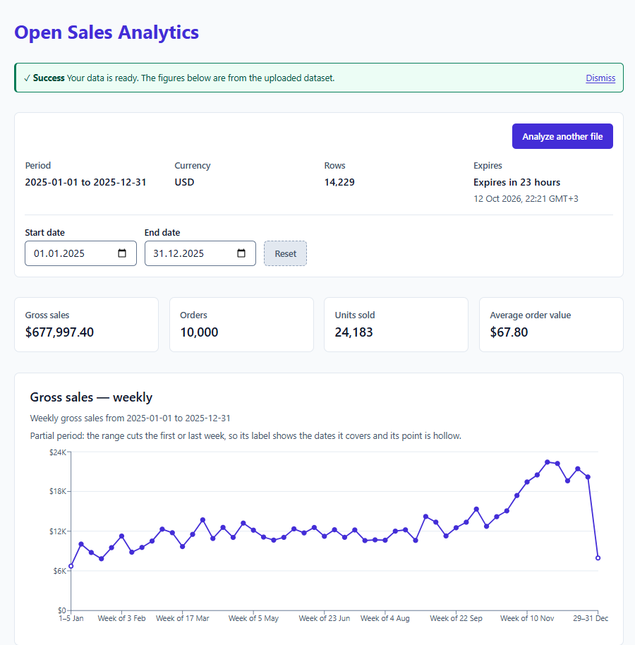
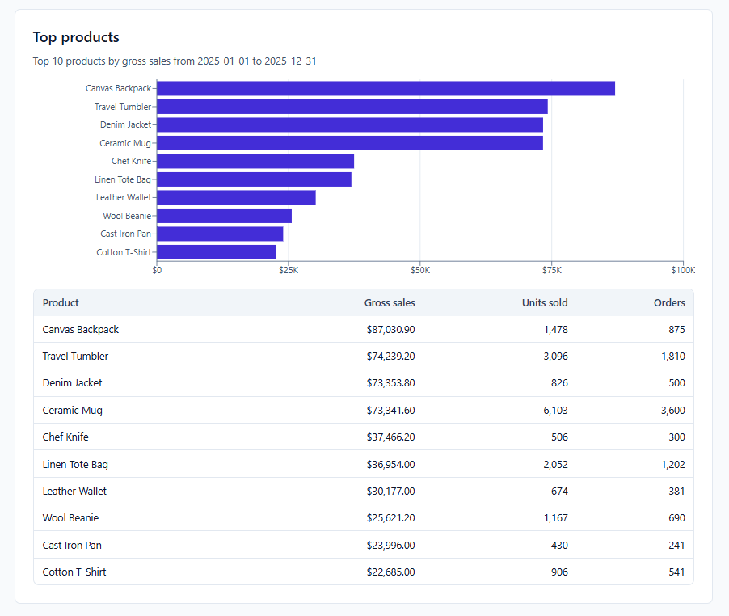

# open-sales-analytics

Open Sales Analytics is a small self-hosted web application. You upload a CSV of completed sales lines and it shows
gross sales, orders, units, average order value, a sales trend and the top products, with a date range you can change.
Gross sales is quantity times unit price, summed over the lines in the chosen period. It has no refunds, discounts,
taxes or shipping in it.

Contents: [Run it with Docker](#run-it-with-docker) | [Configuration](#configuration) | [Demo walkthrough](#demo-walkthrough) |
[Explore the results](#explore-the-results) |
[Product analytics](#product-analytics) | [Comparisons](#comparisons) |
[Dataset contract](#dataset-contract) | [Currencies](#currencies) | [Privacy](#privacy) |
[Demo mode](#demo-mode) | [Limitations](#limitations) | [Architecture](#architecture) | [Development](#development)

## Run it with Docker

There is no published image, so you build it once from a checkout of this repository, then run it:

```sh
docker build -t open-sales-analytics .
docker run -p 8000:8000 open-sales-analytics
```

Open <http://localhost:8000>. You see the upload screen; **Try sample data** opens a dashboard with the sample file.
`curl http://localhost:8000/api/health` returns `{"status":"ok"}`.

The container runs as a non-root user (UID 10001) and keeps its datasets in `/data` (`DATASET_DIR=/data`). Without a
volume they are lost when the container is removed. To keep them, mount a named volume at `/data`:

```sh
docker run -p 8000:8000 -v osa-data:/data open-sales-analytics
```

With the volume, datasets survive `docker restart` and re-creating the container, on a best-effort basis, and each one
still expires after `DATASET_TTL_HOURS`. If you mount a host directory at `/data` instead of a named volume, it must
be writable by the container's non-root user (UID 10001), for example `sudo chown 10001 /path/to/dir`.

The image checks itself: `docker ps` shows `healthy` a few seconds after start, and `unhealthy` when `/api/health`
stops answering (checked every 10 s, 3 s timeout, 3 failures, 10 s start period). `docker stop` ends the server in
under a second with exit code 0, after stopping the background cleanup. The server sets no request timeout of its own
(uvicorn defaults apply), so a very slow upload ends only when the client gives up.

Pass a setting with `-e`, using a variable from the [table below](#configuration):

```sh
docker run -p 8000:8000 -e PUBLIC_DEMO_MODE=true open-sales-analytics
```

## Demo walkthrough

A step-by-step run with generated sample data, from a fresh checkout to the dashboard.
Steps 1 needs [uv](https://docs.astral.sh/uv/); the rest needs only Docker.

### 1. Generate the sample data

```bash
uv run python backend/scripts/generate_sample.py --seed 20260101
```

This writes `backend/app/sample/sample_sales.csv`. The seed makes the file deterministic,
so everyone who runs this gets the same data and the same numbers in step 6.
Run it before `docker build`: the file is copied into the image.

Check the first lines:

```bash
head -n 4 backend/app/sample/sample_sales.csv
```

```
order_id,order_date,product_id,product_name,quantity,unit_price
ORD-000001,2025-01-01,P034,Sunglasses,1,46.00
ORD-000002,2025-01-01,P009,Leather Wallet,2,45.00
ORD-000003,2025-01-01,P001,Ceramic Mug,1,13.20
```

### 2. Build the image

```bash
docker build -t open-sales-analytics .
```

### 3. Run the container

```bash
docker run -p 8000:8000 open-sales-analytics
```

The server is ready when the log shows `Uvicorn running on http://0.0.0.0:8000`.

### 4. Open the web interface

Open <http://localhost:8000>. The upload screen shows the file format and the upload form.

### 5. Upload the sample data

Choose `backend/app/sample/sample_sales.csv`, select **USD** and click **Upload**.
(**Try sample data** imports the same file without choosing it.)


### 6. Explore the results

The dashboard opens on the full period of the data, 2025-01-01 to 2025-12-31:

| Metric              | Expected value |
| ------------------- | -------------- |
| Rows                | 14,229         |
| Gross sales         | $677,997.40    |
| Orders              | 10,000         |
| Units sold          | 24,183         |
| Average order value | $67.80         |



The last point of the weekly chart drops and is hollow: 29–31 Dec is a partial week
(see [Trend buckets](#trend-buckets)), not a fall in sales.

Change **Start date** and **End date** to filter every figure; **Reset** returns to the full period.
Below the trend, the top 10 products by gross sales:



**Analyze another file** deletes this dataset and returns to the upload screen.

The dashboard is organized into Overview, Customers and Products sections. The Customers API currently exposes
aggregate coverage, identified-customer counts, new-versus-returning gross sales, the repeat-purchase rate and the
days between purchases; Products contains the portfolio analyses described in
[Product analytics](#product-analytics).

## Comparisons

The date-range card can compare the active range with the previous period or the same period last year. The dashboard
shows the exact dates returned by the API. A full-range comparison is unavailable when the comparison would begin before
the dataset's first date. Leap-day comparisons use the last valid day of February in the comparison year. A comparison
with no prior value is labelled “No prior value”; two zero values are “No change”; a new product is “New”; otherwise the
percentage is shown as “Comparable”.

## Product analytics

All product figures use the selected inclusive active range unless noted. Money is gross sales: discounts, refunds and
costs are outside this dataset contract. Each product name and ID is displayed as text supplied by the server.

| UI label and key | Formula and denominator | Window and non-normal states | Worked example |
| --- | --- | --- | --- |
| Rankings — `gross_sales` | Sum of quantity × unit price; units sold is sum of quantity; orders is distinct order count | Active range; empty ranges have no products | A line with 2 units at 12.50 contributes 25.00 gross sales |
| Share of gross sales — `gross_sales_share` | Product gross sales / total product gross sales | Active range; insufficient when total gross sales is zero | 15 of 100 is 15.00% |
| Top 20% share — `top_20_percent_share` | Gross sales from the top 20% product count / total gross sales | Active range; insufficient when total is zero | Five products at 50/20/15/10/5: top one is 50.00% |
| Products to reach 80% — `products_to_80_percent` | Smallest ordered product count whose cumulative share reaches 80% | Active range; insufficient when total is zero | 50+20+15 reaches 80% at 3 products |
| Cumulative share — `cumulative_share` | Running gross sales / total gross sales | Active range; unavailable when total is zero | The first three golden products reach 85.00% |
| Product growth — `product_growth` | Current gross sales minus comparison gross sales; percentage uses the comparison value | Comparison period; `New`, `No current sales`, `No change`, or unavailable comparison avoid misleading percentages | 10 to 20 is +10 and +100.00% |
| Rising/falling ranking — `rising_products`, `falling_products` | Rank by absolute gross-sales change | Selected comparison; unavailable when comparison is unavailable | A +10 change ranks above a +900% change of +1 |
| Dormant products — `dormancy` | Products with no sale in the selected 30, 60 or 90-day window; earlier totals use sales before the window | Anchored to the dataset's latest date, default 60; insufficient history or zero result are distinct. A sale exactly N days before the anchor is inside the window | A product last sold 60 days before the anchor is included for a 60-day window |
| Weighted unit price — `weighted_unit_price` | SUM(quantity × unit price) / SUM(quantity) | Active range buckets; missing-sales buckets are gaps, not zero prices | 1 unit at 10 plus 3 at 20 gives 17.50 |
| Order penetration — `order_penetration` | Distinct orders containing the product / all distinct orders | Active range; zero orders is a zero result | 25 of 200 orders is 12.50% |
| Support — `basket_support` | Shared orders / eligible basket orders | Active range; at least 10 shared orders and 0.1% support are required | 10 shared orders in 10,000 gives 0.10% |
| Confidence — `basket_confidence` | Shared orders / orders containing the directional product | Active range; below-threshold pairs are not shown | A→B and B→A can differ because their order counts differ |
| Lift — `basket_lift` | Confidence / support of the destination product | Active range; below-threshold pairs are not shown | Lift compares the observed pair rate with the destination support |

The shared registry labels these keys as: Gross-sales share, Cumulative gross-sales share, Top 20% product share,
Products to 80% of gross sales, Product gross-sales growth, Rising products, Falling products, Dormant products,
Weighted realized unit price, Order penetration, Basket support, Basket confidence and Basket lift.

Pairs below either basket threshold are not shown, even when their lift is high. Orders with more than 100 distinct
products are excluded from basket analysis only; exactly 100 is included, and those orders still count in rankings,
penetration and gross sales. The Products view reports how many were excluded. Price history describes realised price
movement only; it does not measure price elasticity or show that a price change caused a sales change. Rising and falling
uses absolute change so tiny baselines do not dominate. Penetration, support, confidence and lift use distinct orders.

The API documentation is available at [`/docs`](http://localhost:8000/docs). `GET /api/datasets/{id}/overview` returns
overview KPIs and trends; `GET /api/datasets/{id}/products` returns the portfolio analyses; and
`GET /api/datasets/{id}/products/detail?product_id=...` returns one product's detail analyses. Dataset endpoints require
the dataset's bearer token.

## Configuration

The server reads these environment variables when it starts. Every variable is optional.

| Variable | Type | Default | Effect |
| --- | --- | --- | --- |
| `DATASET_DIR` | path | `./tmp_datasets` (`/data` in the Docker image) | Directory that holds one DuckDB file per dataset. Created with private permissions if missing. |
| `DATASET_TTL_HOURS` | integer > 0 | `24` | Hours after which a dataset expires and is deleted. |
| `DATASET_TTL_SECONDS` | integer > 0 | unset | Test-only. When set, the lifetime in seconds, instead of `DATASET_TTL_HOURS`. The browser tests use it to see a real expiry. Leave it unset in production. |
| `MAX_UPLOAD_BYTES` | integer > 0 | `52428800` (50 MB) | Largest accepted upload, in bytes. A larger file is rejected with `file_too_large`. |
| `MAX_ROWS` | integer > 0 | `500000` | Most data rows (header not counted) in one upload. More is rejected with `too_many_rows`. |
| `CUSTOMER_ID_MAX_LENGTH` | integer > 0 | `128` | Maximum Unicode character count for a non-blank `customer_id`; longer values are rejected with `customer_id_too_long`. |
| `CLEANUP_INTERVAL_MINUTES` | integer > 0 | `15` | How often the server removes expired datasets (it also does so once at startup). |
| `PUBLIC_DEMO_MODE` | boolean | `false` | `true` turns uploads off, see [Demo mode](#demo-mode). |
| `MAX_DATASETS` | integer > 0 | `200` | Most unexpired datasets the server holds. Creating one more (an upload or **Try sample data**) answers 503 `capacity_reached` until one expires or is deleted. |
| `RESPONSE_CACHE_MAX_ENTRIES` | integer >= 0 | `256` | Maximum cached Overview/Product responses in this process. `0` disables the response cache. |
| `RESPONSE_CACHE_TTL_SECONDS` | integer > 0 | `300` | Maximum lifetime of a cached Overview/Product response; dataset expiry always wins. |

Booleans accept `true`/`false`, `1`/`0` and `yes`/`no` in any letter case (`on`/`off`, `t`/`f` and `y`/`n` also work).

An invalid value makes the server refuse to start, with an error that names the variable. Invalid means not a number,
zero or negative, a decimal such as `1.5`, an empty string, or a boolean that is none of the spellings above. For
example, `MAX_ROWS=0 uv run uvicorn app.main:app --app-dir backend` exits with `MAX_ROWS  Input should be greater than 0`.

## Dataset contract

One row is one product line within one completed order. The file must have these six required columns plus one optional
column (the same table is on the upload screen):

| Column | Type | Rule |
| --- | --- | --- |
| `order_id` | String | Required and non-empty. Used for distinct order counting. |
| `order_date` | Date | Required ISO calendar date in `YYYY-MM-DD` format. Must not be in the future. |
| `product_id` | String | Required and non-empty. Identifies the product. |
| `product_name` | String | Required and non-empty. One `product_id` must map to exactly one name within an upload. |
| `quantity` | Integer | Required and greater than zero. Zero and negative quantities are invalid. |
| `unit_price` | Decimal | Required and non-negative. A zero price is accepted with a warning; a negative price is invalid. |
| `customer_id` | String | Optional. Blank allowed; up to `CUSTOMER_ID_MAX_LENGTH` Unicode characters (128 by default); use a hashed identifier, UUID or non-personal internal key. Never an email address, phone number, name or other direct identifier. |

File-level rules:

- UTF-8, comma-separated, one header row. The header is row 1 in error reports, so the first data row is row 2.
- Column names are matched after trimming spaces. Order does not matter. A column that is not one of the six required columns or `customer_id` is
  ignored, with a warning (`extra_column`).
- `(order_id, product_id)` is unique: the same product appears at most once per order.
- One name per `product_id` in the whole file.
- Within each order, blank `customer_id` values are filled from its one non-blank ID; conflicting IDs reject the
  upload, while orders with all blanks remain unidentified.
- One currency per upload, chosen in the upload form (see [Currencies](#currencies)).
- Any invalid row rejects the whole file. Nothing is stored.
- At most 50 MB and 500,000 rows by default (the `MAX_UPLOAD_BYTES` and `MAX_ROWS` variables).
- Quantities are whole numbers up to 2,147,483,647. Prices are plain decimals (no currency symbol, no thousands
  separator) with at most 14 digits before and 4 after the point.

### A valid example

Save this as `example.csv`. It has three lines and two orders; order `A-1001` has two lines.

```csv
order_id,order_date,product_id,product_name,quantity,unit_price
A-1001,2025-03-01,P-10,Ceramic Mug,2,12.50
A-1001,2025-03-01,P-20,Travel Tumbler,1,24.00
A-1002,2025-03-02,P-10,Ceramic Mug,1,12.50
```

An optional `customer_id` can be included; blank cells are allowed:

```csv
order_id,order_date,product_id,product_name,quantity,unit_price,customer_id
A-1001,2025-03-01,P-10,Ceramic Mug,2,12.50,CUST-007
A-1001,2025-03-01,P-20,Travel Tumbler,1,24.00,
```

With the app running on port 8000, import it through the API:

```sh
curl -F currency=USD -F file=@example.csv http://localhost:8000/api/datasets
```

The answer is `201` with `"warnings":[]`, a `dataset_id`, a `token` and the first summary. Gross sales here is 61.50
from 2 orders and 4 units.

### Invalid examples

Each is a small change to the valid file. The app answers `422` with the error code `validation_failed` and a list of
errors; the `code` of each error is the one in this table. Each error also carries the row number and the column.

| Change to the valid file | Error `code` | Row |
| --- | --- | --- |
| Remove `unit_price` from the header (and the last value of every row) | `missing_column` | none (file level) |
| Change the date `2025-03-02` to `2025-13-02` | `invalid_date` | 4 |
| Change the quantity of the last row from `1` to `0` | `invalid_quantity` | 4 |
| Repeat the last row | `duplicate_line` | 5 |

### Error codes

The report lists the first 100 errors and gives the total count (`error_count`).

| Code | Cause |
| --- | --- |
| `file_too_large` | The file is larger than `MAX_UPLOAD_BYTES`. |
| `empty_file` | The file is empty. |
| `invalid_encoding` | The file is not valid UTF-8. |
| `malformed_csv` | The file cannot be read as CSV (for example, a single field longer than 131,072 characters). |
| `too_many_rows` | More than `MAX_ROWS` data rows. |
| `no_data_rows` | There is a header but no data rows. |
| `missing_column` | One of the six required columns is not in the header. |
| `duplicate_column` | A required column appears more than once in the header. |
| `missing_value` | A required value is blank. |
| `invalid_date` | `order_date` is not a real date written `YYYY-MM-DD`. |
| `future_date` | `order_date` is after today (UTC). |
| `invalid_quantity` | `quantity` is not a whole number from 1 to 2,147,483,647. |
| `invalid_price` | `unit_price` is not a plain decimal within 14 digits before and 4 after the point. |
| `negative_price` | `unit_price` is below zero. |
| `malformed_row` | The row has a different number of values than the header. |
| `duplicate_line` | The same `order_id` and `product_id` appear on an earlier row. |
| `conflicting_product_name` | One `product_id` has more than one `product_name`. |
| `conflicting_customer_id` | One order has more than one non-blank `customer_id`. |
| `customer_id_too_long` | A non-blank `customer_id` exceeds `CUSTOMER_ID_MAX_LENGTH` Unicode characters. |
| `customer_id_looks_like_email` | A non-blank `customer_id` matches the obvious email heuristic. |
| `customer_id_looks_like_phone` | A non-blank `customer_id` matches the obvious phone heuristic. |

The three `customer_id` checks are a best-effort guardrail, not anonymization and not a compliance guarantee. The email
check looks for `[^@\s]+@[^@\s]+\.[A-Za-z]{2,}` anywhere in the value. The phone check requires only digits, spaces,
`+ - . ( )`, 7–15 digits, and either a leading `+`, visible spacing/parentheses, or at least two `-`/`.` separators.
These heuristics intentionally have known misses: an all-digit phone number such as `05321234567` is accepted, while
digit groups with two dashes such as `2024-01-000123` are rejected. An accepted ID is not thereby anonymous.

A request can also fail before the file is read: a currency that is not in the list answers `400 invalid_request`.

### Customer coverage

When `customer_id` is present, coverage is calculated once during import at order level, after blank IDs have been
filled from another line in the same order:

`identified distinct orders / all distinct orders`

It is not a row percentage, so a five-line identified order counts once. The dataset metadata reports the counts and
the rounded ratio, while the tier is decided from exact integer counts over the whole dataset:

- below 50%: `suppressed`; Customer analytics is unavailable;
- 50% through below 80%: `warning`; Customer analytics is available with a low-coverage warning;
- 80% or more: `normal`; Customer analytics is available normally.

Files without `customer_id` have tier `missing` and `coverage: null`, rather than zero-percent coverage. Coverage
metadata contains counts only and never customer identifiers. Date-range coverage uses the same order-level formula
with inclusive order dates; an empty range has zero counts and `coverage: null`. Tiering remains based on the whole
dataset, so filtering dates does not make the Customers module appear or disappear.

### Customers API

`GET /api/datasets/{id}/customers` is bearer-token protected and accepts the same optional `start`, `end` and
`comparison` query parameters as the Overview and Products module endpoints. With no parameters it uses the full
dataset and the default `previous_period` comparison. Invalid dates, reversed or out-of-range dates return
`400 invalid_range`; an unknown comparison returns `400 invalid_request`. Missing or malformed credentials return
`401 unauthorized` with `WWW-Authenticate: Bearer`; an unknown, expired or deleted dataset returns `404 not_found`.

The typed response contains `module`, `range`, `comparison`, `currency`, `availability`, `coverage` and `sections`.
`coverage.dataset` is the stored whole-dataset coverage and `coverage.range` is the inclusive selected-range coverage;
both contain the tier, rounded coverage ratio and identified, unidentified and total order counts. When coverage is
normal or warning, `sections.identified_customers` reports the distinct identified customers with activity in the
inclusive range, plus the shared comparison value and change fields. An empty active population is a `zero_result`
state. `sections.new_vs_returning` splits identified gross sales in the range into new-customer sales (lines dated on
the customer's first purchase date) and returning-customer sales (later lines), with the same comparison fields;
classification always uses the full-history `first_order_date` from the whole upload, so moving the range start never
turns a returning customer into a new one.

`sections.days_between_purchases` reports reorder timing for the current range only (it has no comparison fields).
Each identified customer's distinct orders are dated by their first line and sorted; each consecutive pair is one
interval in calendar days, and two orders on the same day give `0`. An interval counts when its later order is inside
the inclusive range, even if its earlier order is before the range start; orders after the range end are ignored. The
section returns `median_days` (the mean of the two middle values for an even count, so it can end in `.5`; no mean is
reported), `interval_count`, `contributing_customers` and nine fixed `buckets` (`0`, `1-7`, `8-14`, `15-30`, `31-60`,
`61-90`, `91-180`, `181-365`, `366+` days), each with its `interval_count` and `share` of all intervals. Without an
included interval the median and every share are `null` and the state is `insufficient_data`.

`sections.cohort_retention` is a monthly acquisition-cohort retention matrix for the current range only (no comparison
fields). A customer's cohort is the month of their full-history first order; rows are the cohort months from the month
containing the range start to the month containing the range end, oldest first, so moving only the start never changes a
row. The range end is the `data_cutoff`: customers first seen after it are not members and later activity is ignored,
while activity before the start still counts. Each row has `cohort_month` (`YYYY-MM`), `cohort_size`, `complete_months`
and `cells`; month `N` (0 = acquisition month) has `retained_count` (members with an identified line in that calendar
month) and `retention` (`retained_count / cohort_size`). Each cell's `state` is `complete` (the whole month is on or
before the cutoff), `partial` (the month contains the cutoff; counts so far) or `not_observed` (the month starts after
the cutoff; values are `null`, never `0`). Rows are padded to the same width as the oldest cohort. Without an
overlapping cohort `rows` is empty and the state is `insufficient_data`.

`sections.historical_customer_value` reports observed Historical Customer Value (gross sales already observed, not a
forecast) for the current range only. Its population is the members of the `cohort_retention` rows; a customer's value is
their identified gross sales dated on or before the `data_cutoff` (the range end), including sales before the range start.
It returns `customer_count`, `average` (total value / `customer_count`) and `median` (mean of the two middle values for
an even count), money rounded half-up to 4 decimals. `rows` mirrors the `cohort_retention` rows and cell states, with each
cell's `value_per_customer` = the cohort's cumulative gross sales through the end of month `N` (capped at the cutoff) /
`cohort_size` (`null` when `not_observed`). `all_cohorts` is one point per month offset over the cohorts whose cell is
`complete` (`value_per_customer`, `contributing_cohorts`; `null` and `0` when none is complete). Without a cohort the
state is `insufficient_data`; members whose total value is 0 give `zero_result` with `0.0000` values.

`sections.rfm` reports RFM segment counts for the current range only, with no comparison. Its population (`customer_count`,
N) is identified customers with an identified order on or before the range end; all their identified activity through the
end counts and the range start has no effect. Recency is days from a customer's latest identified line to the
`recency_anchor` (the range end), frequency is distinct orders and monetary is gross sales. Each dimension is scored 1-5 from
the customer's rank: `floor(5 × (2 × worse + ties) / (2 × N)) + 1`, where `worse` counts customers with a strictly worse
value and `ties` those with the same value, so equal values get equal scores and a constant dimension scores 3. With
`FM = F + M`, the first matching rule names the segment: Champions (R ≥ 4, FM ≥ 8), Loyal (R ≥ 3, FM ≥ 6), Potential
Loyalists (R ≥ 4, FM ≤ 5), Needs Attention (R = 3, FM ≤ 5), At Risk (R ≤ 2, FM ≥ 6), Lost (R ≤ 2, FM ≤ 5). `segments`
always lists all six in that order with `customer_count` and `share`; per-customer scores never leave the backend. Fewer
than 5 customers gives empty `segments` and `insufficient_data`. A fixed `note` says segments are relative to this
upload's customer base, not universal benchmarks.

Missing or suppressed coverage omits every section (`sections` is empty). The endpoint always returns `Cache-Control: no-store`.
Customer responses are aggregate-only by design: they never return customer identifiers, customer-level objects,
search, detail, download or export data, and identifiers are not written to logs.

### Warnings

Warnings do not reject the file. They come back in the `warnings` list of the `201` answer and on the upload screen.

| Code | Meaning |
| --- | --- |
| `extra_column` | The file has a column that is not one of the six required columns or `customer_id`, for example a `note` column. It is ignored and not stored. |
| `zero_price` | One or more lines have a unit price of 0. They are imported and count as orders and units, with no gross sales. |

### Sample data

Download a valid sample file at <http://localhost:8000/api/sample.csv> (the upload screen links it as **Download
sample CSV**). **Try sample data** on the upload screen imports the same file in USD without any upload.

## Trend buckets

The trend groups gross sales by calendar bucket. The granularity depends only on the selected range, counting both
end dates: up to 90 days is daily, over 90 days through 730 days is weekly, longer is monthly. The API returns
`bucket_start` per bucket (the bucket's first day) and no coverage field.

- The range is inclusive: the start date and the end date are both in it.
- Weeks run Monday to Sunday; a weekly bucket's `bucket_start` is its Monday. Months are calendar months.
- A bucket the range cuts (a first week or month that starts before the start date, a last one that ends after the
  end date) is a partial period. The chart works this out from the range and the calendar, so a day with no sales still
  counts as covered. A one-day daily bucket is always whole (the data holds dates only); a one-day slice of a week or
  month is partial. A range inside one week or month shows that bucket as partial.
- Partial presentation: the axis label of a partial week or month shows the dates it covers (`29–31 Dec`,
  `10–31 Mar 2025`) instead of `Week of 29 Dec` or the month name, the point is hollow, a note under the chart says
  so, and the tooltip adds the year and `Partial period: <covered dates>`. A whole bucket has none of these.
- Only rows inside the range are summed, so a partial bucket holds the sales of the dates it covers.

## Currencies

The currency is chosen in the upload form: USD, EUR, GBP, TRY, CAD, AUD, JPY, CHF, SEK, PLN. It is only a label for
the amounts. There is no conversion and no exchange rate. Any other code is refused with `400 invalid_request`.

## Privacy

- The raw CSV is deleted as soon as the import ends, on success and on failure.
- Only the six required columns and optional `customer_id` are stored, in one DuckDB file per dataset under `DATASET_DIR`, with private permissions
  (`0600` for the file, `0700` for the directories).
- Customer IDs are pseudonymous data, not anonymous data. They are kept for the dataset's 24-hour lifetime. Use a hashed
  identifier, UUID or non-personal internal key; never upload a direct identifier such as an email address, phone number
  or name.
- The customer-ID length, email and phone checks are best-effort guardrails only. They are not anonymization and are not
  a compliance guarantee; automated checks cannot find every kind of personal data.
- A dataset is deleted after `DATASET_TTL_HOURS` (24 by default) by a cleanup at startup and then every
  `CLEANUP_INTERVAL_MINUTES`, or at once when you click **Analyze another file**.
- Access needs a random bearer token. The browser keeps it in `sessionStorage`, so it is gone when the tab closes.
  The server keeps only a SHA-256 hash of it.
- The logs are one JSON line per request with the method, path, status, duration and the dataset ID. The dataset ID is
  logged on purpose, so a request can be traced; it is not a secret and cannot be used without the token. The logs
  never contain tokens, file contents, file names, product names or order IDs. Error logs hold exception class names
  and stack frames, never exception messages.
- Nothing is sent to other services.
- When customer IDs are supplied, the per-dataset DuckDB file also contains `customer_facts`: one row per identified
  customer with full-history first/last order dates, acquisition month, distinct lifetime orders, units and gross
  sales. It contains no rows for unidentified orders and expires with the dataset; it is not a separate shared database.

## Demo mode

A hosted demo is a public instance run with `PUBLIC_DEMO_MODE=true`: visitors can explore the bundled sample data
only and cannot upload a file. Its datasets expire like any other (`DATASET_TTL_SECONDS`), and it runs as a single
instance. To analyze your own files, [run it yourself](#run-it-with-docker).

`PUBLIC_DEMO_MODE=true` is for a public server that should not take other people's files:

- `POST /api/datasets` answers 403 `upload_disabled` without reading the body.
- **Try sample data** and the sample download keep working.
- The upload screen shows the file format and **Try sample data** only, no file or currency field. It says that it
  accepts sample data only and links to [Run it with Docker](#run-it-with-docker) for uploads.
- `GET /api/config` returns `{"public_demo_mode":true,...}`, which is how the screen knows.
- `MAX_DATASETS` protects the disk on a public server: every click on **Try sample data** creates a dataset, and at the
  cap it answers 503 `capacity_reached`.

## Limitations

- One instance only. There is no horizontal scaling: datasets are files on that instance's disk.
- Surviving a restart is best effort, and only when `DATASET_DIR` is on a volume.
- No accounts and no sharing. A dataset is reachable only with its token, which stays in one browser tab.
- One currency per file.
- Gross sales only: no refunds, discounts, taxes or shipping.
- 50 MB and 500,000 rows by default.
- Desktop and tablet widths (768 px and up). Phones are not supported (see
  [`_docs/design-system.md`](_docs/design-system.md)).

## Architecture

A React (Vite) front end with Recharts talks JSON to a FastAPI back end. Each dataset is one DuckDB file under
`DATASET_DIR`; validation and analytics are SQL over that file. Canonical import builds reusable `order_facts`,
`product_facts` and, when identified customer data exists, full-history `customer_facts` in the same file. An in-process background task removes expired
datasets. The Docker image is a single container in which FastAPI serves both the API and the built front end from one
origin on port 8000. The full specification is in [`_docs/plan.md`](_docs/plan.md) (architecture in section 7), and the
backlog is in [`_docs/tasks.md`](_docs/tasks.md).

## Development

How work is organized: [`_docs/process.md`](_docs/process.md). Testing conventions:
[`_docs/testing-guidelines.md`](_docs/testing-guidelines.md).

From the repository root:

```sh
uv sync
uv run pytest
```

Lint and type checks (the same commands CI runs; `uv sync` installs `ruff` and `mypy` as dev dependencies):

```sh
uv run ruff check backend
uv run ruff format --check backend   # `uv run ruff format backend` fixes it
uv run mypy backend/app
```

Dependency scan (the same two commands the CI `dependency-scan` job runs; `uvx` runs `pip-audit` without making it a
project dependency):

```sh
uv export --locked --no-emit-project --format requirements-txt -o /tmp/requirements.txt
uvx pip-audit@2.10.1 -r /tmp/requirements.txt --no-deps --disable-pip
(cd frontend && npm audit --audit-level=high)
```

Start the backend (serves on http://127.0.0.1:8000):

```sh
uv run uvicorn app.main:app --app-dir backend
```

Check it: `curl http://127.0.0.1:8000/api/health` returns `{"status":"ok"}`. To serve the built front end from the
same origin without Docker, run `npm run build` in `frontend/` first (see below), then start the backend as above and
open <http://127.0.0.1:8000>.

### Frontend

Requires Node 22 or newer. From `frontend/`:

```sh
npm ci            # install
npm run dev       # dev server on http://localhost:5173
npm test          # Vitest, single run
npm run lint      # ESLint
npm run typecheck # tsc --noEmit (TypeScript 7)
npm run build     # type check, then the production bundle in frontend/dist
```

`npm run dev` proxies `/api` to the backend on port 8000, so start the backend too.

### Required CI checks

Merging to `main` is meant to require these four checks, spelled exactly as GitHub shows them on a pull request
(Settings, Branches or Rules, "Require status checks to pass", then pick each name):

- `Backend (tests, ruff, mypy)`
- `Frontend (tests, lint, type check, build)`
- `Dependency scan (Python, npm) / Dependency scan (Python, npm)`
- `Container (build, smoke, browser tests)`

The dependency scan is a call to the reusable workflow `.github/workflows/dependency-scan.yml`, so GitHub shows its
name twice, as `<calling job> / <called job>`. In branch protection select that full, doubled name; the plain
`Dependency scan (Python, npm)` does not match a check run. If you rename a job in `.github/workflows/`, update this
list and the protection setting in the same change, because a required check that no longer exists blocks every merge.
Compare with `gh pr checks <number>` on any pull request.

### Dependency scanning

CI scans both lockfiles on every pull request and every push to `main`, and again every Monday at 05:17 UTC
(`.github/workflows/dependency-scan-scheduled.yml`), so a new advisory against an unchanged lockfile turns a run red
without waiting for the next pull request. Both call one shared definition,
`.github/workflows/dependency-scan.yml`, so the commands and the policy below are identical. The scheduled run has
`contents: read` and no secrets, and can also be started by hand from the Actions tab ("Run workflow").

| Ecosystem | Tool and input | Fails CI on |
| --- | --- | --- |
| Python | `pip-audit` over `uv.lock` (runtime and dev packages) | any known vulnerability (pip-audit has no severity filter) |
| npm | `npm audit --audit-level=high` over `frontend/package-lock.json` | high and critical advisories; low and moderate are shown in the log but do not fail |

A scanner that errors (no network, bad input) also fails the job; the steps have no `|| true` and no
`continue-on-error`. There is no ignore list. If an advisory has no fix yet, the way out is a reviewed pull request
that pins an exception in the scan command with the advisory ID and the reason next to it (`pip-audit --ignore-vuln ID`
or removing the package); it is never a silent skip. Caches hold package downloads and the Playwright browser only;
no dataset, upload, secret or DuckDB file is cached or uploaded as an artifact.

Dependabot (`.github/dependabot.yml`) opens a pull request on Mondays for outdated Python (`uv.lock`, from
`pyproject.toml`) and npm (`frontend/package-lock.json`) dependencies, at most 5 open per ecosystem. Dependabot only
bumps dependencies that already exist; it never adds one. Its pull requests run the same CI as any other, with no
secrets (Dependabot pull requests get a read-only token), so the dependency scan, tests, build and browser suite all
run on the bumped lockfile. Review one like any change: read the release notes and the diff of the lockfile, merge only
when every check is green, and for a major version bump also run the app once by hand. A red check is a reason to
close or fix the pull request, never to merge it.

A failed scheduled run shows as a red run named "Dependency scan (scheduled)" on the repository's Actions tab
(filter by the workflow name or `event:schedule`). GitHub also emails the repository owner: for scheduled workflows it
notifies the user who last changed the `cron` line, so if someone else edits the schedule, check that their
notification settings (Settings, Notifications, Actions) are on. Scheduled workflows run on the default branch only,
and GitHub pauses them after 60 days without repository activity; re-enable one from the Actions tab if that happens.

### Container image pinning

Decision: the base images in the `Dockerfile` (`node:22`, `python:3.12-slim`) are pinned by digest
(`FROM image:tag@sha256:...`, the multi-architecture index digest). Reason: a tag moves, so two builds of the same
commit could differ and an unreviewed upstream change could break or compromise the build; a digest makes the build
reproducible and every base image change a reviewed pull request. Dependabot (`docker` entry in
`.github/dependabot.yml`, Mondays) bumps the tag and the digest together, and the `docker-smoke` CI job builds and
starts the container on the new image before anyone merges. To update by hand, look up the digest of the tag you want
and replace both parts of the `FROM` line. The `uv` image copied in with `COPY --from=ghcr.io/astral-sh/uv:0.8` stays
on its tag for now.

### Pinned actions

The `pinned-actions` job in `.github/workflows/ci.yml` fails when any `uses:` under `.github` is neither a local path
(`./.github/workflows/...`) nor `owner/repo@<40 hex characters>`; the error annotation names the file and line. Write
pins as `uses: owner/repo@<sha> # vX.Y.Z`; Dependabot keeps the SHA and the comment current. The check is a shell
step with `contents: read`, no secret and no third-party action besides `actions/checkout`, so it also runs on pull
requests from forks and from Dependabot.

### Browser test

A small Playwright suite (Chromium, `frontend/e2e/`) covers the primary journeys: Try sample data, a valid upload,
an invalid upload, the date range and Reset, Analyze another file, and an expired dataset.
Install the browser once (about 150 MB, stored outside the repository), then run it from `frontend/`:

```sh
npx playwright install chromium
npx playwright install-deps chromium   # Linux only: system libraries, needs sudo; CI runs it too
npm run e2e
```

`npm run e2e` starts the backend (port 8000) and the Vite dev server (port 5173) itself, with a temporary dataset
directory, and stops them afterwards. Both ports must be free. To test an app that is already running (for example
the container), set `E2E_BASE_URL`; no server is started then. That app must run with `DATASET_TTL_SECONDS=60`, because
the expiry journey waits (bounded polling) for a real expiry:

```sh
docker build -t open-sales-analytics .   # from the repository root
docker run -d --name oca -p 8000:8000 -e DATASET_TTL_SECONDS=60 open-sales-analytics
curl -f http://localhost:8000/api/health   # answers {"status":"ok"}; repeat for a few seconds until it does
curl -f http://localhost:8000/d/anything | grep -i '<div id="root"'   # the single-page app
E2E_BASE_URL=http://localhost:8000 npm run e2e
docker rm -f oca
```

On failure a trace and a screenshot are saved in `frontend/test-results/` (open a trace with `npx playwright show-trace`).
With `CI` set (as on GitHub Actions) no trace is recorded, because a trace contains the network responses, and CI uploads
only the failure screenshots.
